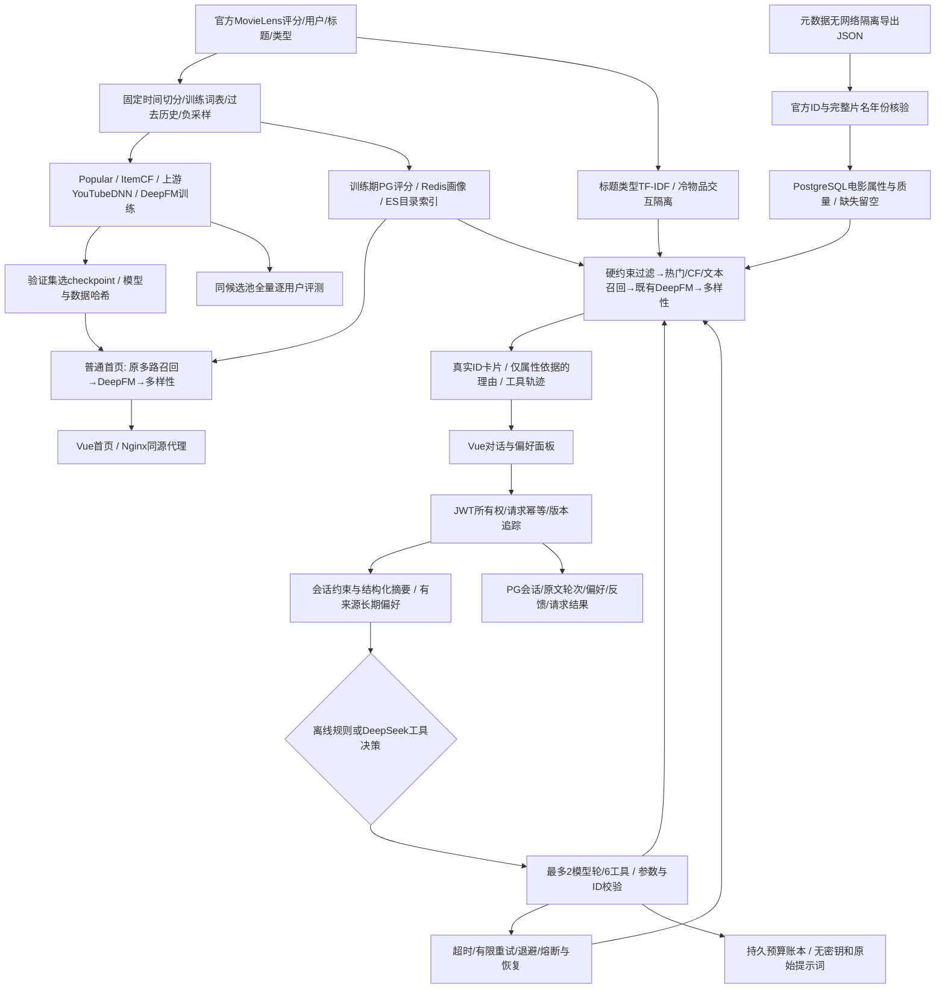

# 已交付架构与数据流

普通首页不经过LLM；对话推荐由模型打分，LLM选择和参数化工具。多路召回失效保留可用通道，缓存失效使用本地训练画像，排序失效使用热门分数，LLM失效执行本地推荐，所有路径保留已知硬约束。外部元数据不在在线关键路径。

长期偏好与会话约束分别保存，长期否定仅在当前未明确覆盖时生效；借用偏好不会固化到会话状态。纠正标记可撤销相反事实；撤销保留来源审计，删除移除偏好值并保留不含值的动作审计。删除偏好不会自动删除独立的原始对话；会话可通过删除API移除。

模型输入仍使用训练期官方特征，不把当前IMDb聚合评分/票数加入历史模型。对话过滤的当前元数据有快照时点限制，不据此宣称历史线上效果。图片未进入模型；text+image对照未执行。

## V2增量
工具输出 → 本地属性证据复核 → 结果返回；无候选 → 计算可行放宽方案 → 前端仅填入建议 → 用户发送确认 → 新一轮解析。API实验通过单独持久账本控制新增额度，普通页面仍用原试跑账本。

## V4测量路径
浏览器performance.now → fetch → API解析/上下文/工具 → 本地推荐与官方LLM → HTTP响应 → Vue nextTick（结果DOM提交）。请求ID关联浏览器、ca_requests和模型账本；每轮tokens合并最多2次模型请求。临时评测JWT在窗口关闭后失效；普通访客原预算不变。
