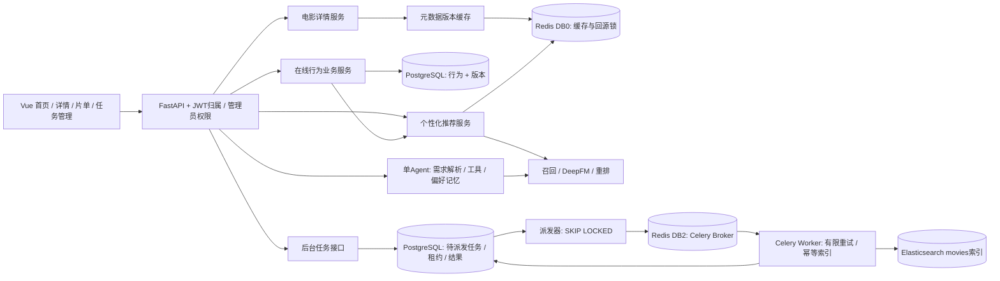

# CineAgent 后端架构与贡献边界

## 本轮个人新增

- app/behavior：独立在线收藏、评分、看过及用户行为版本；路由/业务/模型分层。
- app/jobs：PostgreSQL待派发记录、Celery执行、有限重试、claim及过期租约恢复、管理员接口。
- 推荐结果与详情缓存、用户/版本隔离、并发回源锁和故障回退。
- Alembic增量迁移；请求ID与结构化日志；pytest、隔离CI、真实故障和固定负载测量。
- Vue电影行为组件、片单分页筛选、管理员任务管理；原首页/评分/资料页衔接新在线服务。

## 复用与修复

FunRec固定上游的模型构建器、模型结构、原召回/排序骨架、电影数据库模型和前端骨架继续复用。本轮没有重新训练模型，没有把新增后端能力等同于推荐准确率提升。修复旧评分直接写训练表、事务跨多次提交、个人资料读取旧评分、页面评分后推荐不刷新等衔接问题。

## 一致性与边界

用户写入在PG事务内完成，缓存通过已提交版本自然失效；并发请求可能看到其开始时的旧状态，不承诺响应返回时绝对最新。任务至少一次投递，通过固定电影ID upsert实现业务幂等，不宣称exactly-once。索引最终一致，在线评分不改MovieLens评测标签。普通首页与片单操作无需LLM，原单Agent保留为业务入口，与另一个舆情项目的多Agent/Harness路线区分。

## 没有扩展的范围

本机回环地址部署，不是公网SLA；没有支付、订单、微服务拆分或Kubernetes。未引入多Agent、LoRA或新的RAG。CI合成数据证明接口工程行为，不能代替MovieLens真实推荐评测。
