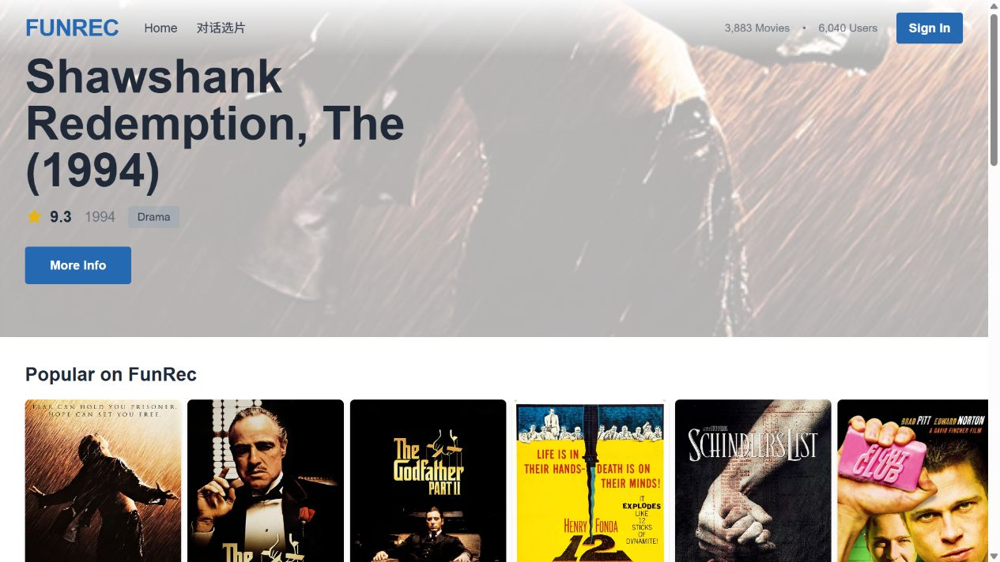
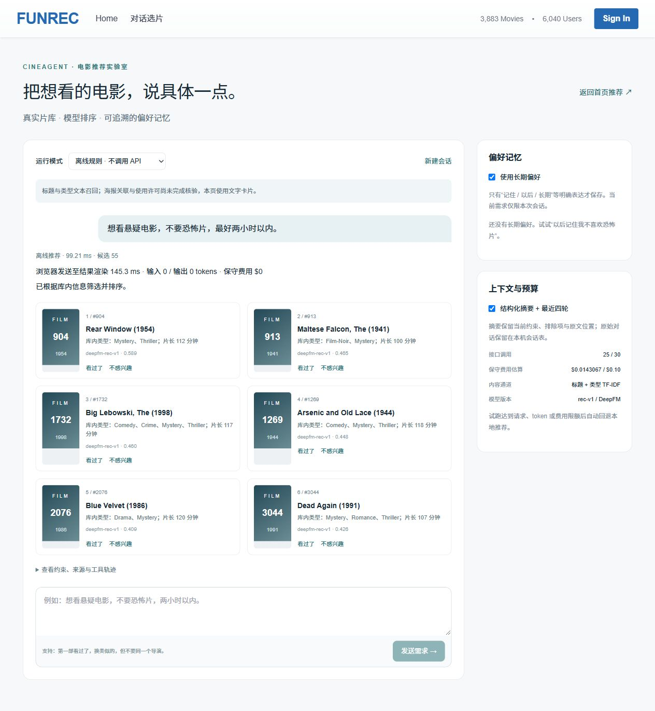
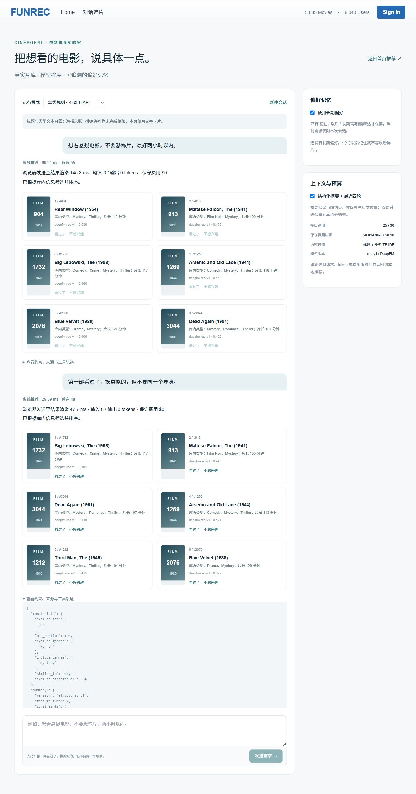
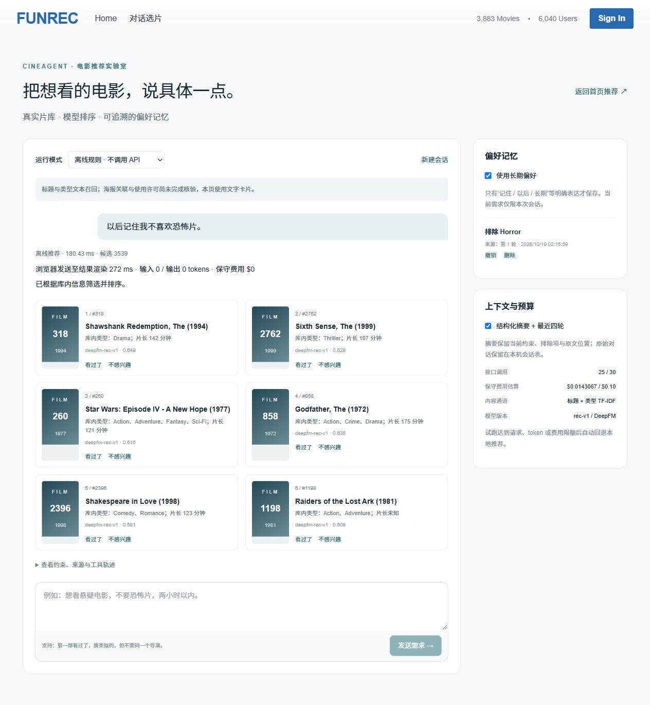
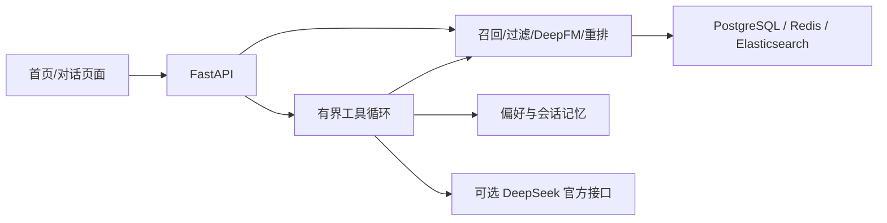

# CineAgent

融合个性化推荐与偏好记忆的对话式电影推荐系统。

> **本项目基于 [Datawhale FunRec](https://github.com/datawhalechina/fun-rec) 增量开发。** 固定上游 commit：`5f7bd84d4403b5f92b6bedbd31e3984ef00a4572`。复用推荐模型构建器、原召回/排序/冷启动及前后端骨架，在此基础上完成运行修复、数据协议、对话 Agent、偏好记忆、可靠性与评测。详见 [个人贡献](CONTRIBUTIONS.md)、[来源说明](UPSTREAM_NOTICE.md) 和 [许可](LICENSE.md)。

## 功能

- 普通首页：多路召回、DeepFM 排序与多样性重排；首页不依赖 LLM。
- 对话选片：类型/片长/排除条件、多轮指代、看过反馈和导演排除；只返回库内真实电影。
- 内容与检索：标题/类型 TF-IDF 内容召回，Elasticsearch 片库搜索。
- 偏好记忆：长期偏好与会话条件分离，来源/时间追踪，纠正、撤销、删除与结构化摘要。
- 工具治理：最多2轮模型决策、6次工具调用；动态参数约束、用户来源校验、库内属性复核。
- 可靠性：超时、有限重试/退避、熔断恢复、分级降级和请求/反馈幂等。
- 约束协商：无候选时提供有候选数依据的放宽方案，确认后才修改条件。

## 页面效果

以下为本机真实运行截图，使用合成电影需求；对话页面选择**离线规则模式**，本次截图未调用付费 API。截图中的耗时仅为本次演示观测，不替代上方评测。侧栏调用/费用为历史试跑累计值。

### 普通首页推荐

复用 FunRec 首页与电影卡片，展示热门及分类电影；普通首页不依赖 LLM。首页海报仅作既有页面展示，不代表完成图像表征或图文召回实验，图片版权归原权利人。



### 对话条件驱动推荐

输入“想看悬疑电影，不要恐怖片，最好两小时以内”，实际筛选出55部候选，再经模型排序与多样性重排返回库内电影。



### 多轮反馈与约束追踪

继续输入“第一部看过了，换类似的，但不要同一个导演”，候选由55部变为48部；轨迹展示排除电影ID、导演约束、召回通道及库内证据复核。

<details>
<summary>展开多轮对话与工具轨迹截图</summary>



</details>

### 偏好记忆

明确表达“以后记住我不喜欢恐怖片”后，侧栏保存排除偏好及来源轮次、时间，并提供撤销与删除。



## 实测结果与口径

| 项目 | 结果 | 条件 |
|---|---|---|
| ItemCF | Recall@20 **0.0942**；NDCG@20 **0.2056** | 990名合格测试用户，全量训练目录减用户训练已评分项；四条已测路线最优 |
| YT100→DeepFM | Recall@20 **0.0431→0.0729**，相对约 **69%** | 对照是YouTubeDNN原始排序，不是ItemCF或整体系统提升 |
| 记忆启停 | 长期排除条件满足 **13/30→30/30** | 合成成对任务，不是满意度/CTR |
| 页面交互 | 首次 **17/20** 场景，恢复后 **20/20** | 20个合成双轮场景；43条尝试含3次自动化失败，保留全部记录 |
| 真实工具循环 | **36轮**，另 **4轮**规则冲突澄清 | 同题规则对照也通过40/40且列表相同，不宣称LLM质量收益 |
| 浏览器时延/成本 | 含LLM的36轮P95 **2.41秒**，约 **$0.00102/轮** | 本机非思考短工具输出，含服务商提示词缓存；fetch发起至Vue DOM更新提交，非物理绘制/生产SLA |
| 故障 | 9项模拟检查与实际Redis中断/恢复 | 本机可复现故障验证 |

**保留负结果：** 神经路线未超过ItemCF；标题/类型内容画像与固定RRF融合未提升暖启动准确率。提供完整协议、排除/失败任务及逐用户结果，不将评分任务称作真实CTR或线上A/B。没有图像编码实验或独立人工满意度结论。

- [完整测量](reports/COMPLETE_V4_RESULTS.md) · [时延及缓存审计](reports/LATENCY_AUDIT_V4.md)
- [评测协议](EVAL_SPEC.md) · [原始逐轮结果](reports/COMPLETE_V4_RESULTS.json)

## 架构



## 运行

默认离线规则模式，无须API key。运行入口 `http://127.0.0.1:13000/chat`，普通首页为根路径。代码已包含，数据、模型和本机密码不随仓库发布；首次需按 [REPRODUCE.md](REPRODUCE.md) 下载、校验、预处理并训练。

建议Windows/PowerShell7、Git、Python及Docker Desktop Linux/WSL2；CPU可运行，不要求GPU。容器Python3.11/TensorFlow2.15，基础镜像及依赖已锁定。基础服务空闲总内存曾约1.8GiB，训练容器上限3GiB；数据包约1.93GB，准备足够磁盘空间。

```powershell
python scripts/init_local.py
./scripts/app.ps1 build
# 继续按 REPRODUCE.md 准备数据、训练与初始化数据库
```

API密钥仅使用本机配置窗口，不写入源码、命令行或仓库。所有付费调用必须另行授权；本仓库不继承作者试验额度，临时付费评测入口默认关闭。历史费用账本仅作为证据存于 `evidence/author_ledgers/`，不放在运行时账本路径；新环境须自行配置并授权API额度。

## 目录

```text
upstream/web_project/backend/   推荐服务与新增 app/cineagent 对话模块
upstream/web_project/frontend/  Vue首页与Chat.vue
upstream/src/funrec/            复用的模型、特征与训练构建器
scripts/ configs/              数据/训练/服务/评测驱动和依赖锁
results/ reports/ eval/         固定协议、合成题库、测量及逐任务结果
source/upstream.patch          相对固定上游的修改补丁
```

[演示步骤](DEMO.md) · [架构](ARCHITECTURE.md) · [复现](REPRODUCE.md) · [来源与贡献](CONTRIBUTIONS.md)
